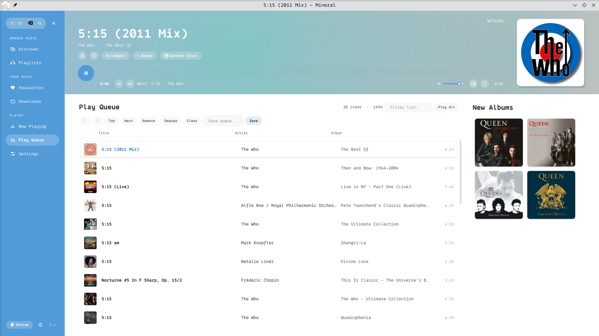
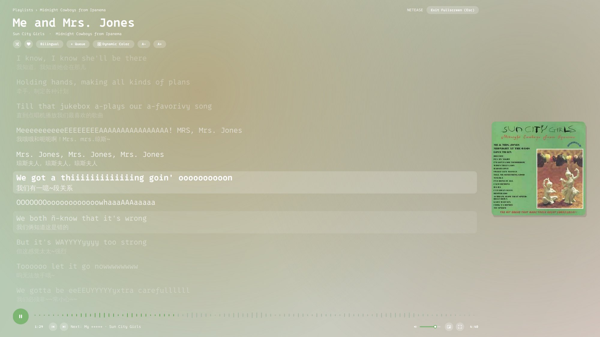
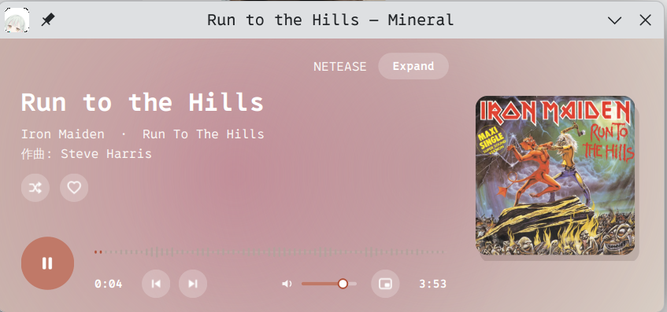

<div align="center">

# Oh-My-Mineral

**[Mineral](https://github.com/10knamesmore/Mineral) 的跨平台桌面图形客户端（Linux / macOS / Windows）**

[](./LICENSE)
[](https://github.com/WeissHymmnos/Oh-My-Mineral/releases)







</div>

## 特性

- **原生跨平台桌面体验** — 支持 Linux (`.rpm` / `.deb` / `.tar.gz`)、macOS (`.dmg`) 与 Windows (`.zip`)，内置 `mineral` 守护进程，开箱即用。
- **随封面动态取色 & 多套 M3 主题** — 从当前播放专辑封面实时提取色板并做平滑色彩过渡，同时内置 Warm Coral、Warm Sage、Editorial Lavender、Nordic Ocean 预设主题。
- **全屏沉浸逐字歌词 & 迷你播放器** — 支持双语/翻译/罗马音歌词同步滚动、字号无级缩放、音频频谱动画以及紧凑 Mini 悬浮窗模式。
- **屏幕刷新率自适应动画** — 所有滚动、非线性弹簧展开、频谱与歌词过渡动画自动同步当前显示器刷新率（60Hz / 120Hz / 144Hz / 240Hz）。
- **GUI 内置扫码登录** — 无需终端，直接在界面中点击即可弹出高清二维码登录**网易云音乐**与 **Bilibili**，登录成功后自动重载守护进程同步歌单。

## 下载与安装

前往 **[GitHub Releases](https://github.com/WeissHymmnos/Oh-My-Mineral/releases)** 下载对应平台的安装包：

- **Linux (RPM)**：`sudo rpm -Uvh mineral-gui-0.1.0-1.x86_64.rpm`
- **Linux (DEB)**：`sudo apt install ./mineral-gui_0.1.0-1_amd64.deb`
- **macOS**：打开 `Mineral-0.1.0-macOS.dmg`，将 `Mineral.app` 拖入 Applications
- **Windows**：解压 `Mineral-0.1.0-win64.zip`，双击运行 `mineral-gui-qt.exe`

## 从源码构建与测试

```bash
cargo test --workspace
cargo build --workspace --release
```

运行客户端：

```bash
./target/release/mineral-gui-qt
./target/release/mineral-gui-gtk
```

## 常用快捷键

- `Ctrl+K`：打开命令与全局跳转面板（输入 `>` 筛选命令，或直接输入关键词搜索/播放）
- `Space`：播放 / 暂停
- `Enter` / 双击：播放歌曲或打开歌单/专辑/艺人详情
- `Shift+Enter`：将选中歌曲加入播放队列
- `+` / `-`：放大 / 缩小歌词字号
- `j` / `k`：上下移动列表选中项
- `N` / `P`：下一首 / 上一首
- `L` / `D`：收藏 / 下载当前选中歌曲
- `/`：聚焦当前列表过滤器
- `T` / `M`：切换歌词轨道（原文/翻译/罗马音）/ 切换循环模式
- `Z` / `Esc`：进入全屏沉浸播放器 / 返回上一层或退出全屏与迷你窗
- `?`：查看快捷键说明

## 许可证

本项目采用 [GNU Affero General Public License v3.0 (AGPL-3.0)](./LICENSE) 开源许可。
